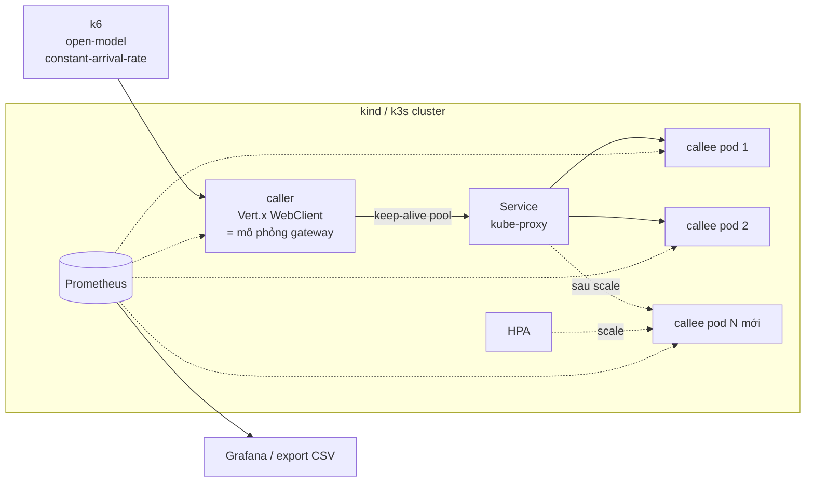

# Scale-out Lab — vì sao pod mới lên mà không gánh được tải

> **Câu hỏi nghiên cứu:** Khi traffic spike làm HPA scale-out một service JVM (Vert.x) trên Kubernetes, vì sao pod mới không giảm tải cho pod cũ — và biện pháp nào thật sự sửa được, đo bằng số liệu?

Bối cảnh: triệu chứng hay gặp ở production — *high traffic → CPU tăng → scale, nhưng traffic đã dồn ở pod cũ, pod mới lên không giải quyết gì*.
Nền lý thuyết: queueing (Erlang C) — khi utilization → 100%, thời gian chờ tăng phi tuyến.

---

## 1. Giả thuyết

| # | Giả thuyết | Dự đoán đo được |
|---|---|---|
| **H1** | **Connection pinning** — kube-proxy cân bằng *theo connection*; pool keep-alive của caller đã mở sẵn tới pod cũ | Sau scale, RPS/pod lệch mạnh: pod cũ ≫ pod mới |
| **H2** | **Hàng đợi không giới hạn** ở pod cũ — request đã xếp hàng không chuyển được sang pod mới | RPS đều nhưng p99 pod cũ vẫn cao; event-loop delay / pending queue tăng |
| **H3** | **Scale quá muộn** — CPU là chỉ số trễ, chuỗi HPA dài | Khoảng `spike start → pod mới phục vụ` dài hơn thời gian spike gây hại |
| **H4** | **JIT lạnh** — pod mới Ready nhanh nhưng chậm trong N giây đầu | p99 pod mới cao trong 10–60 s đầu rồi hội tụ |
| **H5** | **CPU throttling** (cgroup limit) làm pod cũ chậm trước khi CPU "tới 100%" | `container_cpu_cfs_throttled_periods_total` tăng cùng lúc p99 tăng |

Mỗi kịch bản bên dưới **chứng minh hoặc bác bỏ** một giả thuyết — không phải demo.

---

## 2. Topology



- **callee**: Vert.x HTTP server, handler tốn CPU có thể chỉnh (`WORK_US` = số µs CPU mỗi request) → kiểm soát được capacity mỗi pod.
- **caller**: Vert.x `WebClient` với connection pool — đây là nơi pinning xảy ra, giống gateway/service-to-service thật.
- **Load generator phải là open model** (k6 `constant-arrival-rate` hoặc wrk2). Closed model (wrk, ab) tự giảm tải khi server chậm → giấu mất hàng đợi (*coordinated omission*).

---

## 3. Metric bắt buộc

| Nhóm | Metric | Nguồn |
|---|---|---|
| Phân bố tải | RPS **mỗi pod**, số connection đang mở **mỗi pod** | Micrometer (Vert.x metrics) |
| Latency | p50/p99 **mỗi pod** (server-side histogram) + p99 phía client (k6) | Micrometer, k6 |
| Hàng đợi | event-loop delay, pending request của caller pool, request in-flight | Vert.x metrics |
| CPU | usage, **throttled periods** | cAdvisor |
| Scale timeline | thời điểm: spike bắt đầu, HPA desired thay đổi, pod Ready, pod nhận request đầu tiên | k8s events + log |
| Lỗi | 5xx, timeout, connection refused | k6, caller |

⚠️ Tên metric Vert.x/Micrometer cụ thể cần tra theo version dùng — chưa cố định ở đây.

### 3b. Tầng kernel — eBPF

eBPF chạy ở **kernel của node**, không chạy trong pod: triển khai dạng DaemonSet privileged, lọc theo cgroup/pod.
Vai trò: **kiểm chứng độc lập** với metric của app (app có thể đo sai hoặc không thấy hàng đợi trước khi request vào tới code).

| Giả thuyết | Câu hỏi kernel trả lời được | Công cụ |
|---|---|---|
| H1 pinning | Connection TCP nào mở tới pod nào, sống bao lâu, bao nhiêu byte | `tcplife`, `tcpconnect`/`tcpaccept` |
| H2 queue | Request có kẹt **trước khi vào app** không — accept queue tràn, backlog | `nstat` (`TcpExtListenOverflows`), `ss -lnt` (Recv-Q) — không phải eBPF nhưng bắt buộc đi kèm |
| H2/H5 | Event-loop thread chờ CPU bao lâu (run-queue latency), thời gian off-CPU | `runqlat`, `offcputime` |
| H5 throttling | Throttle xảy ra đúng lúc p99 tăng? | cgroup `cpu.stat` (`nr_throttled`) + `runqlat` theo cgroup |
| Mạng | Retransmit, drop | `tcpretrans`, `tcpdrop` |

**Cách triển khai (chọn 1):**
- **Inspektor Gadget** (`kubectl gadget ...`) — eBPF gadget có sẵn, tự gắn metadata pod/namespace. Lựa chọn mặc định. ⚠️ *Tên gadget đã đổi giữa các version — tra docs version cài.*
- **bpftrace / BCC** chạy trên node — linh hoạt nhất, tự lọc theo cgroup.
- **Parca / Pyroscope (eBPF agent)** — continuous CPU profiling toàn cluster (tuỳ chọn, ở M4+).

**Giới hạn:**
- Stack Java JIT qua eBPF hiện ra **không có tên hàm** nếu không có perf-map. Profile CPU của JVM → dùng **async-profiler**; eBPF dành cho kernel / scheduler / TCP.
- **eBPF cần kernel Linux thật có BTF.** kind trên Docker Desktop (macOS) dùng kernel của VM — ⚠️ *chưa kiểm chứng có đủ BTF/quyền*. Phần đo chính chạy trên **GitHub Actions** (Ubuntu runner, 4 vCPU / 16 GB).
- Overhead: tracing per-packet/per-syscall ở tải cao có thể làm méo số liệu → chạy 1 lần có eBPF để chẩn đoán, các lần đo chính tắt eBPF.

---

## 4. Kịch bản

Mỗi kịch bản: **≥ 5 lần chạy**, báo cáo median + khoảng (min–max). Không kết luận từ 1 lần chạy.

| ID | Kịch bản | Thay đổi so với baseline | Kiểm tra | Tiêu chí "sửa được" |
|---|---|---|---|---|
| **S0** | Baseline ổn định | N pod cố định, tải đều, không scale | Phân bố có đều khi *không* scale? | RPS/pod lệch < 10% |
| **S1** | Spike + HPA theo CPU | Tải ×3 trong 5 phút, pool keep-alive mặc định | H1, H3 | — (đây là "bệnh") |
| **S2** | Giới hạn tuổi thọ connection | Caller pool: keep-alive timeout / max lifetime ngắn ⚠️ *tên option theo version* | H1 | RPS pod mới đạt ≥ 80% pod cũ trong X giây |
| **S3** | L7 load balancing | Envoy giữa caller và callee, `LEAST_REQUEST` | H1 | Như S2, so sánh overhead latency của Envoy |
| **S4** | Admission control | Callee giới hạn in-flight, vượt → 503 nhanh; caller giới hạn wait queue | H2 | p99 pod cũ bị chặn trên; lỗi 503 được retry sang pod khác |
| **S5** | Scale theo chỉ số dẫn trước | HPA theo RPS / in-flight (prometheus-adapter hoặc KEDA) + `behavior.scaleUp` nhanh | H3 | Thời gian spike → pod mới phục vụ giảm |
| **S6** | JIT warmup | So p99 pod mới 60 s đầu; thử bắn warmup request trước khi báo Ready | H4 | p99 60 s đầu tiến gần trạng thái ổn định |
| **S7** | CPU limit vs không limit | Cùng S1, bỏ CPU limit hoặc tăng limit | H5 | Throttling biến mất → p99 thay đổi bao nhiêu |
| **S8** | Kết hợp tốt nhất | Tổ hợp biện pháp thắng từ S2–S7 | Tất cả | So S1: p99 toàn hệ thống, lỗi, thời gian hồi phục |

---

## 5. Cấu trúc repo

```
scale-out-lab/
├── README.md              # câu hỏi, kết quả chính, cách chạy
├── apps/
│   ├── callee/            # Vert.x server, WORK_US chỉnh được
│   └── caller/            # Vert.x WebClient, pool option qua env
├── k8s/
│   ├── base/              # Deployment, Service, HPA
│   └── overlays/          # s1..s8 (kustomize)
├── load/                  # k6 scripts (open model)
├── observability/         # Prometheus, Grafana dashboard
├── scripts/
│   ├── run-scenario.sh    # chạy 1 kịch bản × N lần, thu kết quả
│   └── export.sh          # Prometheus → CSV
├── results/<date>-<scenario>/  # raw CSV + summary.md
└── analysis/              # notebook/script vẽ chart từ CSV
```

---

## 6. Milestones

| M | Việc | Đầu ra | Ước lượng |
|---|---|---|---|
| **M0** | Lab: cluster + Prometheus + k6 chạy được (Linux, để eBPF chạy được) | 1 dashboard thấy RPS/pod + 1 lần `tcplife` thấy connection theo pod | 1–2 buổi |
| **M1** | callee + caller + S0 | S0 phân bố đều — xác nhận đo đúng | 1–2 buổi |
| **M2** | S1 tái hiện được "bệnh" | Chart RPS/pod + p99/pod quanh lúc scale | 1–2 buổi |
| **M3** | S2–S4 (connection + queue) | Bảng so sánh với S1 | 2–3 buổi |
| **M4** | S5–S7 (scale signal, JIT, throttling) | Bảng so sánh | 2–3 buổi |
| **M5** | S8 + write-up | Bài viết + chart + giới hạn của nghiên cứu | 1–2 buổi |

**Quy tắc dừng:** nếu M2 không tái hiện được bệnh → dừng, ghi lại vì sao (đó cũng là kết quả).

---

## 7. Giới hạn cần ghi sẵn trong write-up

- Lab ≠ production: 1 máy, mạng loopback, không có service mesh/ingress thật.
- kind trên macOS chạy trong VM Docker — CPU/throttling khác Linux thật; số liệu S7 nên chạy lại trên Linux.
- GitHub-hosted runner là máy dùng chung (noisy neighbour) → phương sai cao hơn máy riêng; luôn chạy nhiều lần, báo cáo khoảng.
- Repo chỉ tái hiện **cơ chế**, không chứa dữ liệu/cấu hình của hệ thống production nào.
