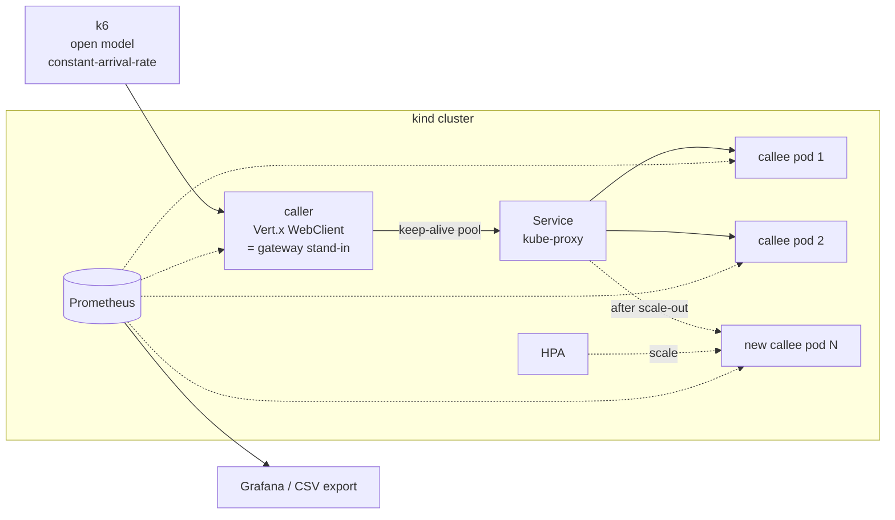

# Scale-out Lab: why new pods don't take the load

> **Research question:** When a traffic spike makes the HPA scale out a JVM (Vert.x) service on Kubernetes, why don't the new pods take load off the old ones? Which fixes actually work, as shown by measurements?

Context: a common production symptom. *High traffic → CPU rises → HPA scales out, but traffic has already piled up on the old pods, so the new pods don't help.*
Theory: queueing (Erlang C). As utilization approaches 100%, waiting time grows non-linearly.

**Status:** M0 done. The GitHub-hosted runner provides 4 vCPU, 16 GB, a kernel with BTF, and working bpftrace and kind ([workflow](.github/workflows/m0-env-check.yml)).

---

## 1. Hypotheses

| # | Hypothesis | Measurable prediction |
|---|---|---|
| **H1** | **Connection pinning.** kube-proxy balances *per connection*, and the caller's keep-alive pool already holds connections to the old pods. | After scale-out, RPS per pod is heavily skewed: old pods ≫ new pods |
| **H2** | **Unbounded queues** on old pods. Requests already queued cannot move to new pods. | RPS is even, but old-pod p99 stays high, and event-loop delay and the pending queue grow |
| **H3** | **Scaling too late.** CPU is a lagging signal, and the HPA chain is long. | `spike start → new pod serving` takes longer than the window in which the spike does damage |
| **H4** | **Cold JIT.** New pods become Ready fast but stay slow for the first N seconds. | New-pod p99 is high for the first 10–60 s, then converges |
| **H5** | **CPU throttling** (cgroup limit) slows old pods before CPU "hits 100%". | `container_cpu_cfs_throttled_periods_total` rises together with p99 |

Each scenario below is meant to **confirm or refute** a hypothesis. None of them is a demo.

---

## 2. Topology



- **callee:** a Vert.x HTTP server with a tunable CPU cost per request (`WORK_US` = µs of CPU per request), so the capacity of each pod is controlled.
- **caller:** a Vert.x `WebClient` with a connection pool. This is where pinning happens, as in a real gateway or service-to-service call.
- **The load generator must be open-model** (k6 `constant-arrival-rate`, or wrk2). Closed-model tools such as wrk and ab back off when the server slows down, which hides the queue (*coordinated omission*).

---

## 3. Required metrics

| Group | Metric | Source |
|---|---|---|
| Load distribution | RPS **per pod**, open connections **per pod** | Micrometer (Vert.x metrics) |
| Latency | p50/p99 **per pod** (server-side histogram), plus client-side p99 (k6) | Micrometer, k6 |
| Queueing | event-loop delay, caller-pool pending requests, in-flight requests | Vert.x metrics |
| CPU | usage, **throttled periods** | cAdvisor |
| Scale timeline | timestamps for: spike start, HPA desired-replicas change, pod Ready, first request served by a new pod | k8s events, logs |
| Errors | 5xx, timeouts, connection refused | k6, caller |

⚠️ Exact Vert.x/Micrometer metric names depend on the version used, so they are not fixed here yet.

### 3b. Kernel layer: eBPF

eBPF runs in the **node's kernel**, not inside the pod. It is deployed as a privileged DaemonSet and filtered by cgroup or pod.
Its role is **independent verification** of the app metrics. The app can mismeasure, and it cannot see queueing that happens before a request reaches app code.

| Hypothesis | What the kernel can tell us | Tool |
|---|---|---|
| H1 pinning | Which TCP connections go to which pod, how long they live, how many bytes they carry | `tcplife`, `tcpconnect`/`tcpaccept` |
| H2 queueing | Whether requests are stuck **before reaching the app**: accept-queue overflow, backlog | `nstat` (`TcpExtListenOverflows`), `ss -lnt` (Recv-Q). These are not eBPF, but they are required alongside it. |
| H2/H5 | How long event-loop threads wait for a CPU (run-queue latency), and off-CPU time | `runqlat`, `offcputime` |
| H5 throttling | Whether throttling coincides with p99 spikes | cgroup `cpu.stat` (`nr_throttled`), plus per-cgroup `runqlat` |
| Network | Retransmits, drops | `tcpretrans`, `tcpdrop` |

**Deployment (pick one):**
- **Inspektor Gadget** (`kubectl gadget ...`): ready-made eBPF gadgets with pod and namespace metadata. This is the default. ⚠️ *Gadget names changed between versions, so check the docs for the installed version.*
- **bpftrace / BCC** on the node: the most flexible option. Filtering by cgroup is done manually.
- **Parca / Pyroscope (eBPF agent):** continuous cluster-wide CPU profiling (optional, M4+).

**Limits:**
- Java JIT frames show up **without symbols** in eBPF stacks unless a perf map is available. Use **async-profiler** for JVM CPU profiling, and eBPF for kernel, scheduler, and TCP.
- **eBPF needs a real Linux kernel with BTF.** kind on Docker Desktop (macOS) uses the VM's kernel, which may lack it. The main runs therefore use **GitHub Actions** (Ubuntu runner), where BTF is verified in M0.
- Overhead: per-packet or per-syscall tracing under high load can distort results. Use eBPF in separate diagnostic runs, and turn it off for the main measurement runs.
- The runner itself is noisy (the runner agent alone made ~5.5k syscalls in 5 s in M0), so always filter by the pod's cgroup.

---

## 4. Scenarios

For each scenario: **≥ 5 runs**, reporting the median and the range (min–max). No conclusions are drawn from a single run.

| ID | Scenario | Change vs. baseline | Tests | "Fixed" criterion |
|---|---|---|---|---|
| **S0** | Steady baseline | N fixed pods, even load, no scaling | Is the distribution even *without* scaling? | RPS skew per pod < 10% |
| **S1** | Spike + CPU-based HPA | 3× load for 5 min, default keep-alive pool | H1, H3 | None. This scenario reproduces the problem. |
| **S2** | Bounded connection lifetime | Caller pool: short keep-alive timeout or max lifetime ⚠️ *option names depend on the version* | H1 | New pods reach ≥ 80% of old-pod RPS within X s |
| **S3** | L7 load balancing | Envoy between caller and callee, `LEAST_REQUEST` | H1 | Same as S2, plus Envoy's latency overhead |
| **S4** | Admission control | Callee caps in-flight requests and returns a fast 503 above the cap. Caller caps its wait queue. | H2 | Old-pod p99 is bounded, and 503s are retried on other pods |
| **S5** | Leading-signal scaling | HPA on RPS or in-flight requests (prometheus-adapter or KEDA), plus an aggressive `behavior.scaleUp` | H3 | Shorter time from spike to new pod serving |
| **S6** | JIT warm-up | Compare new-pod p99 in the first 60 s; try warm-up requests before reporting Ready | H4 | First-60 s p99 close to steady state |
| **S7** | CPU limit vs. no limit | Same as S1, with the CPU limit removed or raised | H5 | Throttling gone; measure how much p99 changes |
| **S8** | Best combination | The winning fixes from S2–S7 combined | All | vs. S1: system p99, errors, recovery time |

---

## 5. Repo layout

```
scale-out-lab/
├── README.md              # question, headline results, how to run
├── apps/
│   ├── callee/            # Vert.x server, tunable WORK_US
│   └── caller/            # Vert.x WebClient, pool options via env
├── k8s/
│   ├── base/              # Deployment, Service, HPA
│   └── overlays/          # s1..s8 (kustomize)
├── load/                  # k6 scripts (open model)
├── observability/         # Prometheus, Grafana dashboard
├── scripts/
│   ├── run-scenario.sh    # run one scenario × N times, collect results
│   └── export.sh          # Prometheus → CSV
├── results/<date>-<scenario>/  # raw CSV + summary.md
└── analysis/              # scripts that chart the CSVs
```

---

## 6. Milestones

| M | Work | Output | Estimate |
|---|---|---|---|
| **M0** ✅ | Lab environment: a cluster, eBPF, and a runner check | Runner verified: 4 vCPU / 16 GB, BTF, bpftrace, kind | 1–2 sessions |
| **M1** | callee + caller + Prometheus + k6 + S0 | Even distribution in S0, which confirms the measurement setup | 1–2 sessions |
| **M2** | S1 reproduces the problem | Charts of RPS per pod and p99 per pod around the scale-out | 1–2 sessions |
| **M3** | S2–S4 (connections + queueing) | Comparison table vs. S1 | 2–3 sessions |
| **M4** | S5–S7 (scale signal, JIT, throttling) | Comparison table | 2–3 sessions |
| **M5** | S8 + write-up | Article, charts, and the study's limitations | 1–2 sessions |

**Stop rule:** if M2 cannot reproduce the problem, stop and document why. That is also a result.

---

## 7. Known limitations (to state in the write-up)

- The lab is not production: a single machine, loopback networking, and no real service mesh or ingress.
- kind on macOS runs inside a Docker VM, so CPU and throttling behaviour differ from bare Linux. Re-run S7 on Linux.
- GitHub-hosted runners are shared machines (noisy neighbours), so variance is higher than on dedicated hardware. Always do multiple runs and report ranges.
- The repo reproduces **mechanisms** only. It contains no data or configuration from any production system.
